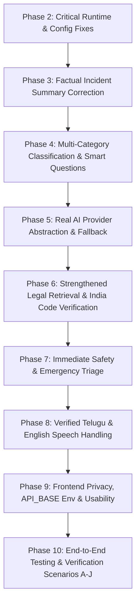

# Legal Tantra: Comprehensive Repository Audit Report

**Date**: October 16, 2026  
**Auditor**: Antigravity Senior Engineering Team  
**Repository**: [https://github.com/skgowse/Tantra.git](https://github.com/skgowse/Tantra.git)

---

## 1. Executive Summary

Legal Tantra is designed as an AI-assisted legal awareness and incident preparation platform for ordinary Indian citizens under the new Indian criminal and procedural codes (**BNS 2023**, **BNSS 2023**, **BSA 2023**), with bilingual support (**English** & **Telugu**). 

The application currently has a working single-page React frontend with a dark obsidian sidebar layout and a FastAPI backend with SQLite storage. However, an architectural audit reveals substantial legacy dead code, broken test imports, hardcoded assumptions (such as forcing all civil/consumer disputes into criminal police complaints), and fabricated factual assertions in generated police statements.

---

## 2. Existing Functionality

| Component | Current State | Notes |
| :--- | :--- | :--- |
| **Frontend (React + Vite + TS)** | **Functional** | Sidebar layout, bilingual toggles, chat interface, 5-stage progress indicator, document analyzer view, print formatting. |
| **Backend API (FastAPI)** | **Operational** | `/api/health`, `/api/chat/message`, `/api/incident/analyze`, `/api/incident/summary`, `/api/legal/library`, `/api/document/analyze`. |
| **Database** | **Functional (SQLite)** | Tables `legal_provisions`, `incident_sessions`, `incident_reports` auto-created and seeded in `legaltantra.db`. |
| **Safety Detection** | **Partial** | Keyword detection for physical threats in English & Telugu, emergency numbers modal (112, 108, 1091, 1930). |
| **Emotion-Aware Prefixes** | **Functional** | Emotion cues (fear, distress, anger, confusion) trigger calming prefixes. |
| **Voice / Speech API** | **Partial** | Uses browser Web Speech API (`SpeechRecognition` & `SpeechSynthesis`); Chrome/Edge only, alerts on unsupported browsers. |

---

## 3. Critical Defects Identified

### 🔴 Critical Defect 1: 100% Failure Rate in Backend Test Suite
- `tests/test_rag.py`: Fails with `ImportError: cannot import name 'get_ai_provider' from 'app.services.ai_service'`. The function was never implemented.
- `tests/test_auth.py`: Fails with HTTP 404 because `/api/auth/register` and `/api/auth/login` are defined in `app/routers/auth.py`, but `main.py` never registered or included any routers from `app/routers/`.
- `tests/test_cases.py`: Fails with HTTP 404 because `/api/cases` router is not included. Furthermore, `app/routers/cases.py` imports `User, Case, CaseFacts` from `app.models.models` which do not exist in the active schema.

### 🔴 Critical Defect 2: Factual Fabrication in Incident Statement Generator
In `backend/app/main.py` lines 177–180:
```python
statement = f"""...
- Specific actions: {impact}
- No provocation was initiated by the complainant.
...
"""
```
The generator explicitly inserts: **`- No provocation was initiated by the complainant.`** regardless of whether the user reported or mentioned provocation. This directly violates the core rule against fabricating unstated facts in incident summaries.

### 🔴 Critical Defect 3: Criminalization Bias (Forcing All Matters into Police FIR Statements)
- The backend defaults to requesting an FIR under BNS 2023 for **every** incident, even when the user describes property boundary disputes, civil breach of contracts, consumer fraud, tenancy issues, or family disputes.
- In `backend/app/services/ai_service.py`, `classify_incident_category` only supports `Threat`, `Assault`, `Fraud`, `Theft`, `Online harassment`, `Road accident`, and `General incident`. Non-criminal and civil categories are absent.

### 🔴 Critical Defect 4: Phantom AI Provider Integration
- `backend/app/services/ai_service.py` checks `GEMINI_API_KEY` and `OPENAI_API_KEY`, but contains **no SDK calls or HTTP requests** to either Google Gemini or OpenAI.
- The provider abstraction is non-existent (`get_ai_provider` missing), meaning setting API keys does not actually connect to live LLMs.

### 🔴 Critical Defect 5: Configuration & Database URL Inconsistency
- `backend/app/config.py` defaults to `DATABASE_URL = "postgresql://postgres:securepassword123@db:5432/legal_assistance"`.
- `backend/app/database.py` defaults to `DATABASE_URL = "sqlite:///./legaltantra.db"`.
- `docker-compose.yml` attempts to boot a Postgres container with `pgvector`, while the actual codebase uses zero pgvector features.
- Default production secrets (`JWT_SECRET`, `ENCRYPTION_KEY`) are committed with hardcoded sample values in `config.py` and `.env.example`.

### 🔴 Critical Defect 6: Hardcoded API Endpoints in Frontend
- `frontend/src/App.tsx` has `const API_BASE = 'http://localhost:8000/api'`.
- It ignores Vite environment variables (`import.meta.env.VITE_API_BASE`), breaking containerized or non-localhost deployments.

---

## 4. High-Priority Improvements

1. **Clean Architecture & Router Alignment**:
   - Align `main.py` and service layers so that the citizen incident workflow (intake, safety, fact extraction, legal retrieval, summary generation) is modular, tested, and cleanly separated.
2. **True Hybrid AI Integration & Fallback**:
   - Implement a clean `AIProvider` protocol with `GeminiProvider`, `OpenAIProvider`, and `DeterministicFallbackProvider`.
   - Validate structured responses against strict Pydantic schemas.
3. **Factual Integrity Guardrails**:
   - Strip all hardcoded assumptions (`no provocation initiated`, mandatory FIR demand).
   - Tag facts explicitly as "Reported by user" vs "Uncertain / Unconfirmed" vs "Legal Provision Suggestions".
4. **Expanded Multi-Category Legal Retrieval**:
   - Expand beyond criminal offenses to handle **Civil Property Disputes**, **Consumer Protection Act 2019**, **Domestic Violence (PWDVA 2005)**, **Family Court matters**, and **Missing Persons**.
   - Distinguish police jurisdiction from Consumer Fora, Civil Courts, and DLSA (Legal Aid).
5. **Robust Automated Testing Suite**:
   - Implement unit and integration tests for scenarios A through J covering emergency guidance, non-criminal classifications, contradictory facts, missing details, and provider failure fallback.

---

## 5. Implementation Roadmap (Phases 2–10)


